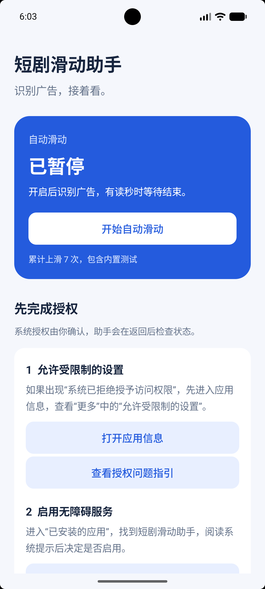
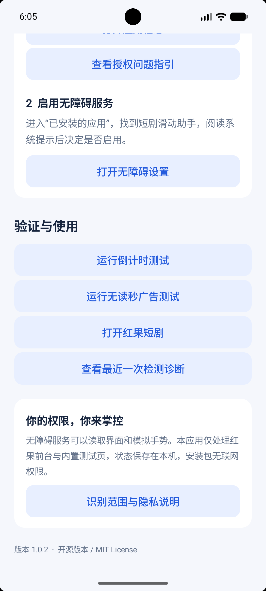

<p align="center"></p>

# 短剧滑动助手

一个使用 Android 无障碍服务识别短剧广告提示、自动执行向上滑动的开源工具。界面和识别逻辑均在本机运行，最低支持 Android 9。

**当前版本为实验性预览版 1.0.2，仅适配红果短剧。** 蓝果等其他应用需要单独适配。1.0.2 已通过规则回归测试和模拟器手势测试，真实红果广告的修复效果仍待真机复测。

[下载安装包](https://github.com/liufengqq/short-drama-swipe-helper/releases) · [反馈问题](https://github.com/liufengqq/short-drama-swipe-helper/issues) · [MIT License](LICENSE)

## 界面截图

以下为 1.0.2 在 Android 模拟器中的实际界面，展示启停、授权、测试和诊断入口。截图中的累计次数包含内置测试。

<table>
  <tr>
    <th>主页与授权引导</th>
    <th>测试与问题诊断</th>
  </tr>
  <tr>
    <td></td>
    <td></td>
  </tr>
</table>

## 工作方式

开启自动滑动后，助手每 400ms 检查目标应用向无障碍服务提供的文字与内容描述。

| 广告状态 | 处理方式 |
| --- | --- |
| 底部显示“X秒后可继续上滑观看短剧” | 跟踪秒数，等待结束提示 |
| 底部显示“上滑继续观看短剧” | 提示稳定约 600ms 后向上滑动一次 |
| 同时存在金币奖励计时或优惠券时钟 | 优先处理继续观看短剧的提示，过滤已适配的奖励与优惠券计时 |
| 缺少可靠的广告或结束信号 | 等待，不执行手势 |
| 切换到其他应用、锁屏或点击暂停 | 清空当前判断状态，停止后续判断 |

连续广告会重新判断，成功手势之间至少间隔 3 秒。每次执行一个上滑手势，后续页面行为由红果决定。

### 适用范围

- 目标应用包名为 `com.phoenix.read`，另处理当前打开的内置测试页。
- 识别依据为系统暴露的界面文字。图片、视频、受保护界面中的文字可能无法读取。
- 当前没有 OCR。广告文案、节点结构或应用版本变化后，可能需要修改规则。
- 无障碍已启用，也需要在主界面点击“开始自动滑动”。
- iOS 无法安装此 APK，目前没有 iOS 版本。

## 安装与使用

### 第一步，安装并授予权限

从下方版本发布页下载 APK，在手机上安装后打开助手。

[下载 1.0.2 预览版](https://github.com/liufengqq/short-drama-swipe-helper/releases/tag/v1.0.2)

点击“打开无障碍设置”，在系统的“已安装的应用”或“已下载的应用”中找到“短剧滑动助手”，阅读系统提示后自行启用。若系统拒绝授权，按应用内“查看授权问题指引”操作，具体入口取决于手机系统。

### 第二步，开启自动滑动并测试

返回助手，点击主页的“开始自动滑动”。向下滚动，分别运行“倒计时测试”和“无读秒广告测试”。保持屏幕解锁并等待助手自动上滑，测试时不要手动滑动屏幕。

### 第三步，打开红果观看

点击“打开红果短剧”，在红果前台观看内容。助手发现已适配的底部读秒时会等待，确认“上滑继续观看短剧”提示后执行一次上滑。

需要停止时返回助手，点击“暂停自动滑动”。要撤销界面访问能力，请在系统无障碍设置中关闭本服务。

测试次数会计入累计上滑次数。内置测试检测收到的手势，手动滑动也可能触发通过提示。

### 系统拒绝授权

Android 13 及以上版本可能对侧载应用访问无障碍等敏感能力增加限制。可通过助手内的“打开应用信息”查看系统提供的“允许受限制的设置”入口，阅读提示后自行决定是否允许。

不同品牌、系统版本、安装来源及企业管理策略可能影响入口和授权结果。若没有相应入口或持续被拒绝，请记录系统提示并咨询设备厂商或管理员。

相关说明见 [Android 官方受限制设置帮助](https://support.google.com/android/answer/12623953?hl=zh-Hans)。

### 开启后广告没有滑动

请在广告页停留后返回助手，打开“查看最近一次检测诊断”，再提交问题反馈。

建议提供以下内容，并自行遮盖录屏中的通知和个人信息。

- 手机型号和 Android / 系统版本。
- 红果版本、助手版本，以及内置两项测试是否通过。
- 广告底部提示的录屏或截图。
- 最近一次检测诊断的截图。

诊断只保存节点数量、广告标记、候选秒数和结束提示等判定摘要。窗口为空或文字节点为零时，可能是目标界面未向无障碍服务提供内容。

## 隐私与权限

无障碍授权具有读取界面和模拟手势的能力。当前代码限制处理范围为红果前台与内置测试页，这属于代码约束，系统授予的服务能力范围仍然较广。

- 没有联网、联系人、外部存储或截图权限。
- 没有账号系统、第三方统计 SDK 或运行时第三方库。
- 界面原文仅在内存中用于判断，未持久化页面原文。
- 本机私有设置保存开关、最近状态、诊断摘要及累计上滑次数。
- 系统日志仅记录助手状态。卸载会清除本机私有设置。
- 服务按真实自动化用途声明 `isAccessibilityTool="false"`。

请只对信任的安装来源和源码授权。彻底撤销访问，请到系统无障碍设置关闭服务。

## 验证情况

| 项目 | 当前状态 |
| --- | --- |
| 倒计时状态机、文案解析及干扰计时回归测试 | 已通过 |
| APK 签名及 Manifest 权限范围检查 | 已通过 |
| 源码压缩包独立构建 | 已通过 |
| 模拟器覆盖安装、授权入口和两项自动手势测试 | 已通过 |
| 1.0.1 真实红果广告识别 | 收到未触发反馈 |
| 1.0.2 按用户录屏修复后的真实广告效果 | 待真机复测 |
| 各品牌设备与其他短剧应用 | 待验证 / 待适配 |

模拟测试不能覆盖目标应用在真机上是否提供无障碍文字，以及所有广告样式和系统安全策略。

## 本地构建

使用 Python 3.9+、JDK 17+ 和 Android SDK。构建脚本面向 macOS/Linux，无 Python 外部依赖。

预先安装 Android SDK Platform 35 和 Build Tools 36.0.0，然后设置本机路径。

```sh
export JAVA_HOME=/path/to/jdk
export ANDROID_HOME=/path/to/android-sdk
export ANDROID_PLATFORM=android-35
export ANDROID_BUILD_TOOLS=36.0.0
python3 build.py
```

开发时也可使用其他已安装且包含所用 API 的平台。本项目本机验证使用 OpenJDK 27、平台 android-37.0 和 Build Tools 36.0.0，应用 minSdk 为 28、targetSdk 为 35。

脚本执行断言测试、检查服务权限和目标包名，再编译、打包、签名、验证 APK，生成中文文件名安装包及 SHA256.txt。GitHub Release 附件使用英文文件名，并附对应的校验文件。

### 签名

首次本地构建默认生成 `.local/debug.p12` 开发密钥，使用 Android 标准开发密码。对外发布请使用自己安全保管的发布密钥。

```sh
export SIGNING_KEYSTORE=/private/path/release.p12
export SIGNING_ALIAS=your-alias
export SIGNING_PASSWORD_FILE=/private/path/password.txt
python3 build.py
```

发布包沿用本项目早期测试版的本地签名。使用不同密钥自行编译的 APK 无法覆盖安装发布包。签名私钥和密码均由维护者私下保管，仓库只包含源码、资源和公开的校验信息。

## 项目结构

```text
src/local/hongguo/adhelper/
  MainActivity.java       主界面、启停、授权引导及诊断
  AdHelperService.java    目标界面读取和系统手势
  AdSignals.java          广告与计时文案解析
  CountdownDetector.java 倒计时及结束状态判断
  TestActivity.java       两种内置广告测试
res/                     Android 资源和服务声明
assets/app-icon.png      图标原图
tests/                  纯 Java 断言测试
build.py                 构建、测试和签名脚本
```

## 贡献与反馈

欢迎通过 Issues 报告广告样式和兼容性问题，通过 Pull Request 改进规则。修改识别逻辑时请补充相应测试，并运行 `python3 build.py`。涉及权限或数据处理的变化，请同步更新文档。

图标由 AI 生成，原图与适配资源随源码提供。项目采用 [MIT License](LICENSE)。

## 联系作者

使用问题、兼容性反馈或合作咨询，可联系作者邮箱。

[303905888@qq.com](mailto:303905888@qq.com)

反馈时请附手机型号、系统版本、助手和红果版本、两项内置测试结果及检测诊断截图。录屏和截图发送前请遮盖个人信息。
